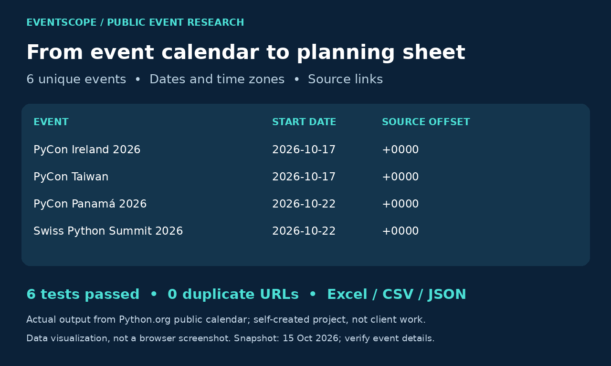

# EventScope



## What is this project used for?
EventScope turns public event-calendar listings into a research spreadsheet. It helps teams plan conference attendance, research industry events and maintain a dated event directory without manually copying listings.

Unlike a product scraper, it handles event start dates, source time-zone offsets, locations, date filtering and source links. It does not collect personal contacts.

## Run
Requires Python 3.12+.
```bash
python -m pip install -r requirements.txt
python eventscope.py
python -m unittest -v
# Optional live fetch of one public calendar page
python eventscope.py --refresh
# Optional filter (replace with your required date)
python eventscope.py --from-date 2026-10-01
```

## Deliverables
- `output/events.xlsx`: formatted workbook with filters and a frozen header.
- `output/events.csv` and `events.json`: reusable structured records.
- `output/events-report.html`: readable results with original source links.
- `output/quality_report.json`: count, duplicate check, source and processing timestamp.
- `source/python-events.html`: the saved source used for reproducible tests.

## Verified example
The included snapshot produced six unique event listings with no skipped invalid records. Six tests cover parsing, ordering, duplicates, missing dates, export parity and empty-output handling. The tests intentionally target the committed snapshot; a future refreshed page can have a different count.

## Provenance and limits
Source: https://www.python.org/events/python-events/ . Real public listings, self-created extraction project, not paid client work. Dates and locations can change. Source offsets are retained; midnight timestamps can be calendar defaults, not actual session start times. Only one calendar page is fetched. The parser is specific to this source and does not claim broad website compatibility. No login or access restrictions are bypassed.
